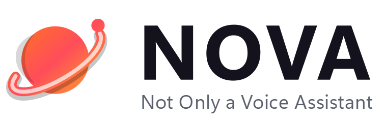

<p align="center">
  <picture>
    <source media="(prefers-color-scheme: dark)" srcset="assets/wordmark-dark.png">
    
  </picture>
</p>

Say **"Hey Nova"** and ask anything, including things that need the web (weather, news, scores). NOVA answers out loud using Claude (through your signed-in Claude Code CLI, no API key). It lives at the bottom centre of your screen (a pixel-art mascot peeking up from the edge, or a glowing orb notch) and in the tray.

## Run it

```powershell
.\start.ps1            # background, no window
.\start.ps1 -Console   # in this window with live logs (Ctrl+C to quit)
```

First time on a new machine: `powershell -ExecutionPolicy Bypass -File setup.ps1`

## Using it

**"Hey Nova" starts a conversation.** After that, just talk: no wake word between turns.

- **"Hey Nova, what's the capital of France?"** in one breath, or **"Hey Nova"**, wait for the chime (two soft rising notes), then ask.
- When NOVA finishes, the card shows **Your turn** with a bar that runs down. Reply any time in the next **10 seconds** ("and what about Germany?").
- **Talk over NOVA** to interrupt it. It briefly turns itself down to check it's really you (not its own echo), then stops and listens. Saying "wait" or "stop" is enough. On headphones NOVA notices there's no echo and switches the echo canceller off, because it would otherwise muffle your voice while NOVA talks (the log says "Echo canceller bypassed").
- **The conversation ends** after 10 seconds of silence, when you say **"that's all"**, **"goodbye"**, **"stop listening"** or **"never mind"**, or when you click the notch while it's listening.
- **Click the notch** while NOVA is talking to stop it (the conversation continues).
- **Your words appear on the notch as you speak.** The live caption is a rough guess (offline Vosk); when you stop, Whisper's more accurate text replaces it, and that's what NOVA answers.
- **"New conversation"** / **"start over"** makes Claude forget what you talked about. It also forgets by itself after 5 minutes of not being used.
- **Current information**: NOVA looks it up, says a quick "Let me check." while the card shows what it's doing, then answers. Questions it can answer from what it knows aren't looked up (no wait).
  - **Weather** ("what's the weather?", "will it rain tomorrow?", "weather in Cebu this weekend?"): live data from Open-Meteo, for your city unless you name another. Answer in ~5 s. If Open-Meteo's main server can't be reached from your network (it happens with some ISPs), NOVA switches to its other servers by itself.
  - **News** ("what's in the news?", "any tech news?", "world news"): fresh Google News headlines for your country, each with how long ago it was published. Answer in ~3-4 s.
  - **Anything else current** ("who won the last F1 race?"): a web search. Answer in ~8-10 s.
- **Your PC** (a short fixed list, nothing else):
  - **Media**: "pause the music", "next song", "previous track" (media keys: Spotify, YouTube, …).
  - **Volume**: "what's the volume?", "set the volume to 30", "turn it up/down", "mute".
  - **Timers**: "set a timer for 10 minutes", "set a pasta timer for 8 minutes", "how long is left?", "cancel the timer". When one is done NOVA chimes, says so, and the notch pops up (even when muted; if you're mid-conversation, right after its current answer). Click the notch to stop it. Timers are forgotten if NOVA quits.
  - **Opening apps** you've allowed: "open Spotify", "open my browser". Choose them in **NOVA settings > Apps**.
  - **Spotify** (once it's allowed under Apps): "play Blinding Lights", "play some Taylor Swift", "play the album Abbey Road", "put on my focus playlist" (your own playlists first), "play my liked songs", "what song is this?". It uses Spotify's own command-line tool (`spotify_cli`, which comes with the Spotify app) through the account you're logged into: no API key, no web search, and Spotify starts if it isn't open. It only searches and plays: it never changes your playlists, library or queue. Answer in ~3-5 s.
  - It **can't** delete, move or edit files, run commands, install or remove anything, change other settings, close apps, or shut down/restart. Ask, and it says so.
- **Reminders**: "remind me at 5 to call Mum", "remind me in 20 minutes to check the oven", "remind me every weekday at 8 AM about stand-up", "what reminders do I have?", "cancel the dentist reminder". When one is due NOVA chimes and says it (like a timer). Reminders survive restarts; one that came due while NOVA was off is announced when it starts ("You missed a reminder from…").
- **Notes and lists**: "note that the wifi password is sunflower 42", "what's the wifi password?", "add milk and eggs to my shopping list", "what's on my shopping list?", "clear the shopping list", "delete the wifi note". Deleting moves notes to a **bin for 30 days**; there's no "delete all my notes" by voice.
- **Hover the notch** while it's idle to see what's next: "Next: pasta timer 3:12 · call Mum, 5:00 PM".

## The notch

Pick its look from the tray: right-click > **Mascot** (remembered):

- **Pixel mascots: Black cat, Robot, Fox, Frog, Ghost, Axolotl.** They peek up from the bottom edge of the screen, in the centre (just ears and eyes, the frog's eyes, the ghost's round top…). They blink and glance around while they wait. Say "Hey Nova" (or hover) and they pop up with a card above them: perked ears / bigger eyes while you talk (and a hop with your voice), looking up while thinking, glancing left and right while searching the web, a moving mouth with NOVA's voice, asleep with small drifting z's while muted, sad when something goes wrong.
- **Orb**: the classic notch, a thin glowing pill that opens into a panel with the orb beside the text: a glowing core inside a mesh of points and links that keeps gently changing shape. It swells with your voice and NOVA's, spins faster while thinking or searching, turns grey when muted and red on an error.
- **Fullscreen apps** (games, videos, presentations): the notch hides while one is in front and comes back after. NOVA still listens and talks.

The card:

- **Status** (Listening / Thinking / Searching the web / Your turn) with a small level meter. A thin bar along the bottom moves while NOVA thinks or searches, and runs down while it waits for your reply.
- **Text**: your words live while you talk; then your question in small print above NOVA's answer, which grows with the reply.
- **See-through**: in dark mode it's black glass (translucent black, no blur, so what's behind shows through darkened); in light mode Windows blurs what's behind it (acrylic, like Start and the flyouts). It follows your Windows accent colour. On dark themes the black cat gets a faint outline so it doesn't disappear.
- Left-click: stop NOVA talking (or end the conversation if it's listening). Right-click: the tray menu.

The pixel mascots are drawn as text in `nova\pixel*.py` (one character per pixel), so they're easy to edit; the orb is `nova\orb.py`. Preview every state without talking: `.venv\Scripts\python.exe tools\notch_preview.py` (writes `samples\notch_preview_<mascot>.png` and `samples\mascot_frames.png`).

## Tray icon

- The icon is your mascot's head (the black cat's has a white outline so it shows on a dark taskbar), or the orb with a little star; grey and asleep when muted.
- Left click: mute or unmute the wake word. **Muting also frees NOVA's video memory** (~1.7 GB down to ~0.1 GB; the last 0.1 GB stays until you quit). RAM is freed too (NOVA uses ~0.2-0.3 GB while running). After unmuting NOVA is ready in ~1-3 s, using its smaller speech model for the ~9 s it takes the accurate one to reload.
- **Show notch** (right-click menu) hides or shows the notch; your choice is remembered. NOVA still listens and chimes with it hidden.
- Right click (quick settings): Mute wake word, New conversation, Show notch, **Mascot**, **Voice**, **Open NOVA** (its window, below), **Settings** (the window, with settings open), **Restart NOVA** (picks up a new build; NOVA's window comes back as it was), Quit NOVA.

## NOVA's window

NOVA's main app. Right-click the tray icon > **Open NOVA** (or **Settings**, which opens it with settings showing). Resize it, maximise it, or make it fullscreen.

- **Your mascot in the centre.** Each pixel mascot peeks up over a pixel-art scene of its own, drawn at the mascot's own pixel size and on the same pixel grid, so mascot and scene are one picture: the cat over moonlit rooftops, the robot over a space-station deck, the fox in an autumn forest at dusk, the frog in a pond at night, the ghost on a misty hill under a big moon, the axolotl on the sea floor. The orb floats on a plain, dark background.
- **The colours follow your mascot** (the cat's amber eyes, the robot's blue screen, the fox's orange, the frog's green, the ghost's periwinkle, the axolotl's pink; the orb uses your colour theme), and so does the font: Pixelify Sans with the pixel mascots, Outfit with the orb (both in `assetsonts`, SIL Open Font License).
- **The conversation** under the mascot: your words live as you speak, then your question above NOVA's answer (in a pixel text box over the scenes).
- **The eyes follow your cursor** for a few seconds after you move it, anywhere on the screen (the notch's mascot does it too): the cat and the robot look all eight ways, the fox, frog, ghost and axolotl left, right and down. Hover over the mascot and it perks up. The orb's glowing core leans towards the cursor.
- **Mic indicator** (top right): a microphone with signal bars that lights up whenever your mic picks up sound loud enough for NOVA to count as speech (the same threshold it records with, set from your room's noise), and stays on while NOVA is listening. The bars show how loud you are. It shows even when everything else is hidden, and never while muted.
- **Move the mouse or press a key** and a few things fade in: the time, date and weather (top left), what's next (timers, reminders) and what Spotify is playing (bottom corners), and four buttons: talk, mute, settings, fullscreen.
- **Idle** (no conversation, no mouse or keys for 3 seconds): it all fades away, the pointer too, and only the mascot stays.
- **Click the mascot** (or press **Space**) to talk without saying "Hey Nova"; click it again to stop NOVA. **F11** or a double-click: fullscreen; **Esc**: closes settings, then leaves fullscreen; **Ctrl+,**: settings; right-click: the tray menu.
- Closing the window only hides it (NOVA keeps listening in the tray). While it's open, the notch steps aside.

## NOVA settings

Inside NOVA's window: the settings button (or **Ctrl+,**, or tray > **Settings**) slides them in from the right, laid out like Windows 11 Settings and accented in your mascot's colour. Changes save straight away; most apply at once, and the few that need a restart show a **Restart NOVA** button.

| Page | What's there |
|---|---|
| **Home** | What NOVA is doing, what's next (timer / reminder), wake word and notch switches, "Start fresh" (new conversation), things to try |
| **Timers** | Running timers with a live countdown and a cancel button; start one by typing (minutes, seconds, name) |
| **Reminders** | Upcoming reminders (delete); add one with a date/time picker and repeat (once, every day, weekdays, every week) |
| **Notes** | Notes and lists, filtered by list (Shopping, Todo, …); add, edit, move to the bin; the **Bin** keeps deleted notes 30 days (restore) |
| **Apps** | Every app in your Start menu with a switch: switch on the ones NOVA may open, and add nicknames ("browser" for Zen). Terminals, system tools and uninstallers are locked off |
| **Appearance** | Mascot picker; **colour theme** for the logo and the orb (Sunrise, Ocean, Aurora, Forest, Graphite, Nebula, or your Windows accent colour); show the notch; hide over fullscreen apps; live captions |
| **Voice** | Voice picker (NOVA says hello in the new one); speaking speed |
| **Assistant** | Your city (weather, news), Claude's model (Haiku / Sonnet), time to reply, and switches for looking things up, PC control, reminders and notes |
| **Privacy & safety** | What NOVA can and can't do, and buttons to open the folders with your notes, the log and the settings |

Settings changed here are saved in `state.json` and win over `config.toml` (which is never rewritten).

### Voices

Right-click the tray icon > **Voice** to switch voices any time. NOVA says "Hi, I'm Nova" in the new voice, and remembers your choice (in `state.json`).

- **Kokoro voices** (Bella, Heart, Sarah, Nicole, Emma, Michael, Fenrir, George) run on your PC: no internet needed for speech. On the GPU (RTX 4050) a sentence takes ~0.4-0.8 s to make; on the CPU it's 2-5x slower.
- **Microsoft voices** (Ava, Andrew) are online: usually fast, occasionally slow when the service is busy.
- If a voice fails, NOVA falls back to the other kind, then to the built-in Windows voice.
- Add more voices to the menu in `config.toml` (`[voice] menu`).

## Settings

Edit `config.toml`, then restart NOVA. Main ones:

| Setting | What it does |
|---|---|
| `[wake] wait_for_command` | Seconds to wait for your question after "Hey Nova" + pause (default 6) |
| `[wake] end_silence` | Seconds of quiet that end your question (default 1.0) |
| `[conversation] enabled` | Keep listening after each answer (default true) |
| `[conversation] follow_up_timeout` | Seconds of silence before the conversation ends (default 10) |
| `[conversation] talk_over` | Talk over NOVA to interrupt it (default true; uses echo cancellation) |
| `[mic] device` | Part of your mic's name; empty = Windows default |
| `[speech_to_text] model` | `large-v3-turbo` (default, most accurate, needs the GPU), `small.en` or `base.en` (faster, less accurate). Compare them on your own voice: `.venv\Scripts\python.exe tools\stt_compare.py` |
| `[speech_to_text] vocabulary` | Names and words it should expect (keep "Claude" in here) |
| `[speech_to_text] device` | `cuda` (GPU, default) or `cpu`. Falls back to CPU if CUDA fails. Kokoro uses the GPU automatically when it can |
| `[claude] model` | `haiku` (fastest) or `sonnet` |
| `[claude] location` | Your city (`"Manila, Philippines"`): the default for weather, and which country's news you get. Empty = NOVA asks which city |
| `[claude] web_search` | Let Claude look things up: web search, weather and news (default true) |
| `[voice] name` | Starting voice, e.g. `kokoro:af_bella` or `edge:en-US-AvaMultilingualNeural` (the tray choice overrides it) |
| `[voice] kokoro_speed` | Speaking speed for Kokoro voices (default 1.05) |
| `[voice.pronunciations]` | How to say a word, spelled the way it sounds (e.g. `Magdaong = "Mugduh-ong"`). Only the voice changes; the text keeps the real spelling |
| `[pc] enabled` | Media keys, volume, timers, opening allowed apps and Spotify (default true) |
| `[reminders] enabled` | Reminders and notes (default true) |
| `[ui] theme` | Colour theme for the logo and the orb: `sunrise` (default), `ocean`, `aurora`, `forest`, `graphite`, `nebula` or `accent` |
| `[ui] mascot` | Starting look: `cat`, `robot`, `fox`, `frog`, `ghost`, `axolotl` or `orb` (the tray's Mascot menu overrides it) |
| `[ui] accent` | Colour for the notch's bars and caret; empty = your Windows accent colour |
| `[ui] notch` | Show the notch (default true; the tray's Show notch overrides it) |
| `[ui] hide_in_fullscreen` | Hide the notch while a game, video or presentation is fullscreen (default true) |
| `[ui] live_captions` | Show your words on the notch as you speak (default true) |

## Start with Windows

```powershell
powershell -ExecutionPolicy Bypass -File install-startup.ps1           # add
powershell -ExecutionPolicy Bypass -File install-startup.ps1 -Remove   # remove
```

## Safety

A misheard sentence (or a trick in a web page) can't run commands, touch your files or break your PC, because Claude simply has no way to:

- **Its only tools**: web search, and NOVA's own short list: weather and news (read-only: Open-Meteo and Google News, no API keys), media keys, volume, timers, opening apps you've ticked, playing music on Spotify (search and play only), and reminders and notes. No Bash, PowerShell, file or settings tools exist in its session, and anything else that would need permission is refused automatically.
- **No tool can** delete, move or edit your files, run commands, install or uninstall, change settings other than the volume, close apps, or shut down, restart, sleep or sign out.
- **Reminders and notes** live only in NOVA's own `data` folder, and the tools can't reach anything else. Deleted notes go to a bin for 30 days (restore them from the tray). Clearing everything at once by voice isn't possible. The files are written safely (a crash can't leave half a file), and an unreadable file is set aside rather than overwritten.
- **Every input is checked** (types, allowed values, ranges, lengths): e.g. volume 0-100, timers 1 second to 24 hours, at most 10 timers.
- **Apps** open only if you ticked them, by the Start-menu ID saved when you did (never a name or path Claude makes up), through Explorer like clicking them in Start. Terminals, system/admin tools and uninstallers can't be ticked at all, and are refused even if `state.json` is edited by hand.
- **NOVA's tools listen only on 127.0.0.1** (not reachable from the network), need a secret that's new every time NOVA starts, and refuse requests from web pages. Every tool call is logged in `logs\nova.log`.
- Set `[claude] web_search = false` and `[pc] enabled = false` for a Claude with no tools at all.

Try the weather and news tools on their own: `.venv\Scripts\python.exe nova\tools_server.py --test "Manila, Philippines"`

## Logo

NOVA's logo is **Slingshot**, a planet with an orbit swinging around it: `assets\nova.svg` (and `assets\nova-small.svg`, simplified for 16-24 px), drawn by Codex. It's the icon of NOVA's windows and of the startup shortcut; the tray shows your mascot.

**Colour themes** (NOVA settings > Appearance, or `[ui] theme`) recolour the logo and the orb: Sunrise (default), Ocean, Aurora, Forest, Graphite, Nebula, or your Windows accent colour. The SVGs use three placeholder colours (`#0000F1`, `#0000F2`, `#0000F3`) that `nova\themes.py` swaps for the theme's. After editing the SVGs, run `.venv\Scripts\python.exe tools\make_logo.py` to remake the PNGs, `assets\nova.ico` and the README wordmarks (in the default theme, Sunrise).

## Troubleshooting

- Logs: `logs\nova.log`
- Test the wake word on its own: `.venv\Scripts\python.exe tools\mic_test.py`
- List microphones: `.venv\Scripts\python.exe tools\mic_test.py --list`
- GPU: the log should say `kokoro ready on CUDAExecutionProvider` and `whisper large-v3-turbo on CUDA`. If it says CPU, re-run `setup.ps1` (it installs `requirements-gpu.txt`: onnxruntime-gpu 1.26 + NVIDIA's CUDA 12 libraries, ~2.4 GB in `.venv`). Without the GPU, NOVA uses `base.en` for speech-to-text (turbo is too slow on a CPU).
- Misheard words: run `.venv\Scripts\python.exe tools\stt_compare.py` (quit NOVA first). You read 15 phrases and it shows how each speech-to-text model did on your voice.
